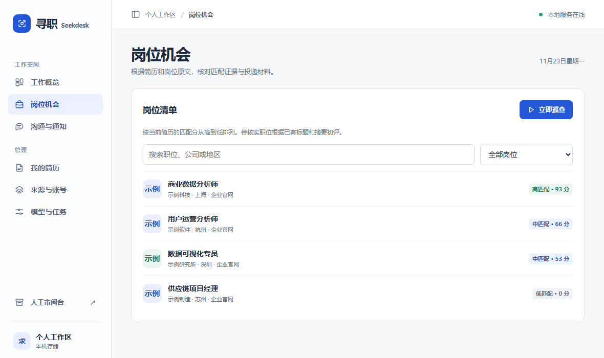

# 寻职 Seekdesk

寻职是运行在个人电脑上的求职工作台。上传一份简历，就能把多个来源的岗位按匹配分排在同一张清单中。点开职位，可以看到分数依据、对应的简历经历、材料建议和原始链接。



*界面示例使用虚构简历和岗位。*

## 在 Windows 上开始

1. 安装 Python 3.10 或更高版本，确保终端能运行 `py -3` 或 `python`。
2. 从 GitHub 下载并解压仓库，或执行下列命令获取代码。

   ```sh
   git clone https://github.com/222222222l/job-review-prototype.git
   cd job-review-prototype
   ```

3. 双击项目根目录的 [启动工作台.cmd](启动工作台.cmd)。首次启动需要联网安装 Python 依赖与 Chromium，完成后会在浏览器中打开工作台。
4. 在「我的简历」上传文字版 PDF、DOCX、TXT 或 Markdown 文件。回到「工作概览」，点击「立即巡查」，在「岗位机会」查看结果。

首次巡查默认使用本地关键词匹配和 GitLab、Spotify 的公开招聘板。你可以先体验排名，再按需要添加招聘平台账号、模型或通知渠道。自动打招呼、受邀发送简历和定时巡查初始均关闭。首次运行的端口通常是 `8765`，实际地址以启动窗口为准。

## 手动安装

在 Windows PowerShell 中运行以下命令。

```powershell
py -3 -m venv .venv
.\.venv\Scripts\python.exe -m pip install -r requirements.txt
.\.venv\Scripts\python.exe -m playwright install chromium
.\.venv\Scripts\python.exe serve.py --open
```

在 macOS 或 Linux 终端中运行以下命令。

```sh
python3 -m venv .venv
.venv/bin/python -m pip install -r requirements.txt
.venv/bin/python -m playwright install chromium
.venv/bin/python serve.py --open
```

若 Linux 提示 Chromium 缺少系统库，可使用 `.venv/bin/python -m playwright install --with-deps chromium` 安装所需依赖。服务仅监听本机回环地址。关闭网页后服务仍可运行，在启动终端按 Ctrl+C 可退出。

## 可以接入什么

| 需要 | 工作台提供的选项 |
| --- | --- |
| 发现岗位 | Greenhouse、Lever 企业招聘板，企业官网招聘页，BOSS 直聘、猎聘、智联招聘的独立登录窗口 |
| 搜索招聘官网 | 本地 SearXNG 插件、Brave Search、Tavily |
| 匹配简历 | 本地关键词初评、外部 Agent CLI、第三方模型 API、本机模型服务 |
| 管理投递 | 根据匹配门槛和每日联系上限发起沟通，识别简历邀请和联系方式请求；动作与回执可在工作台查看 |
| 接收提醒 | Windows 通知中心、QQ / 163 / 126 快捷邮件、自定义 SMTP |

招聘平台接入依赖官网当前开放的页面和账号权限。官网要求人工验证时，该平台暂停后台直连，其他来源继续运行。索引线索和卡片会标明「待核实」。使用时请遵守各平台的账号和服务规则。

## 数据与隐私

- 简历原件、提取文本、岗位、通知记录和登录会话保存在本机，默认目录为 `.workbench/personal/`。
- Windows 使用当前用户的 DPAPI 保护保存的服务密钥。macOS 和 Linux 当前以明文保存这些密钥，应使用仅当前用户可访问的数据目录。
- 选用外部模型时，生成查询和评分所需的简历、岗位文本会发送到所选服务。搜索引擎会收到岗位查询词。备份、截图和问题报告中都可能包含个人信息。

## 文档

- [使用指南](docs/usage.md)涵盖来源接入、SearXNG、模型切换、排名、定时巡查、通知及常见问题。
- [开发与测试](docs/development.md)说明项目结构、隔离测试方法和验证范围。
